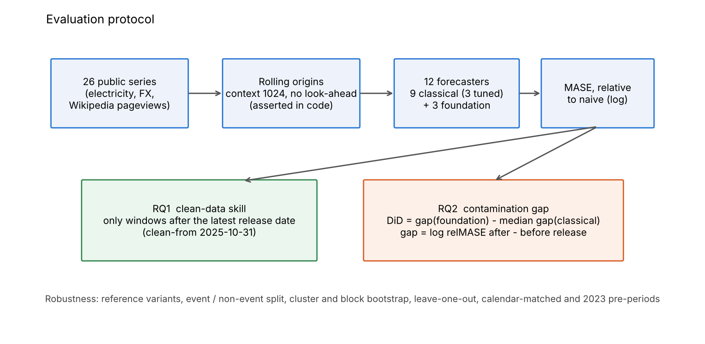
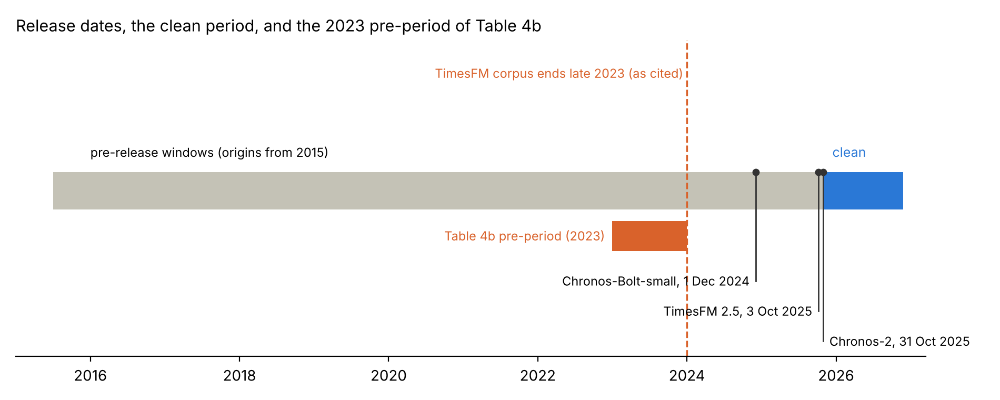
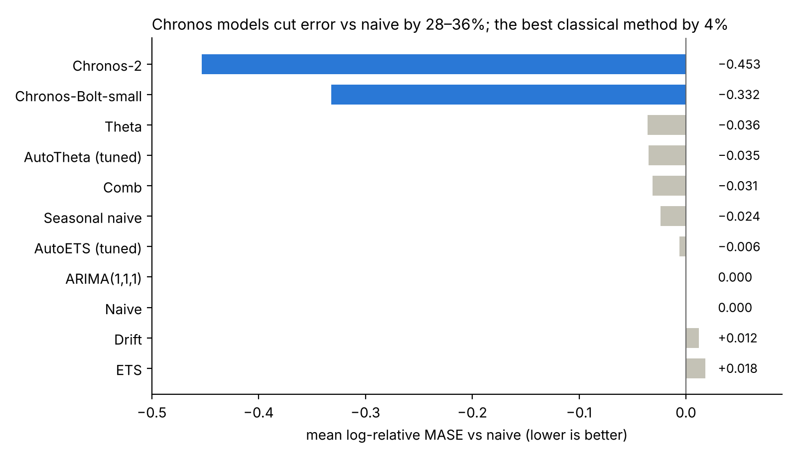
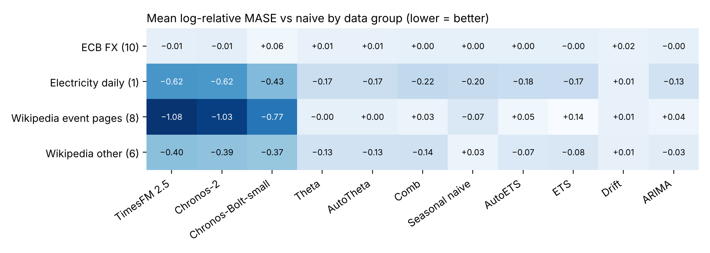
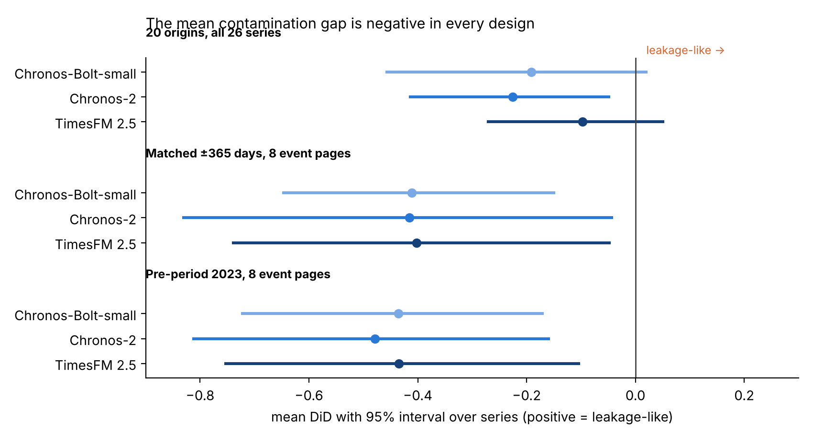
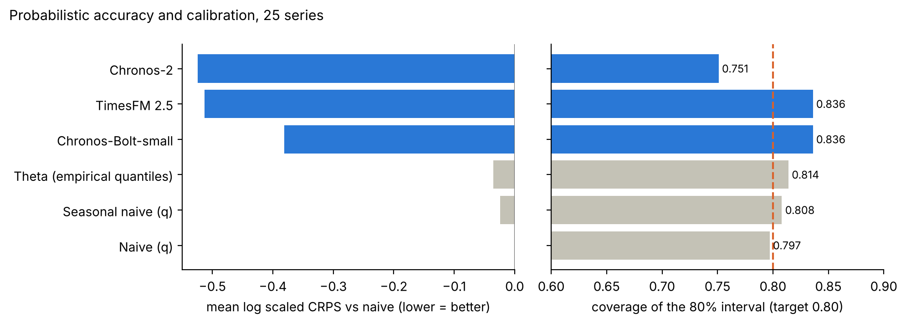

# ForecastClean

**Do pretrained time-series foundation models really beat classical forecasters when they are tested only on data they could not have seen?**

Leakage-aware, rolling-origin evaluation of Chronos-Bolt, Chronos-2 and TimesFM 2.5 against classical forecasters on 26 public series.

Author: Mirza Yasir Abdullah Baig · Licence: MIT · Status: paper draft v0.5, about **90% of the way to a preprint** · Last updated 2026-11-28

Paper draft: [`paper/PAPER.md`](paper/PAPER.md) · Reading notes for the supervisor: [`paper/READING_NOTES.md`](paper/READING_NOTES.md) · How to reproduce: [`REPRODUCE.md`](REPRODUCE.md) · Release steps: [`RELEASE_CHECKLIST.md`](RELEASE_CHECKLIST.md)

---

## 1. Summary for the supervisor

### The question
Foundation models are pretrained on huge collections of time series. If a test series, or the period it covers, was in that training data, the model's accuracy looks better than it really is. We ask two things:

- **RQ1.** On windows that start *after* every model's release date (so the data is clean), do the foundation models still beat classical methods?
- **RQ2.** Is each model's advantage over classical methods larger *before* its release than *after*? A larger advantage before release would be a leakage-like signature. We measure it as a difference-in-differences (DiD): the change in the foundation model's relative error across release minus the same change for classical models. A positive DiD is leakage-like.

### What we found

| | Finding | Where |
|---|---|---|
| RQ1 | On clean data all three foundation models beat every classical method, tuned or not: about 28% (Chronos-Bolt-small), 36% (Chronos-2) and 37% (TimesFM 2.5) lower error than naive, against 3–4% for the best classical method. | Paper §5.1, Figures 2–3 |
| Where the lead comes from | Electricity demand and Wikipedia pageviews only. On exchange rates every method ties with the random walk. | Figure 3 |
| RQ2 | **No consistent leakage signature.** The mean DiD is negative for all three models in every design we tried (different origin samples, a calendar-matched design, a pre-period placed before TimesFM's documented corpus end). On the 18 series that are not calendar-event pages it is within ±0.04 and its intervals include zero. | Paper §5.2, Figures 4–5 |
| One open item | Hourly electricity (one series) is the one consistently positive gap. We bound it: the foundation models stay far ahead after release, and seasonal methods move the same way. We cannot explain it with one series. | Paper Table 4c, Figure 6 |
| Probabilistic accuracy | Same picture as for point forecasts. Chronos-2's 80% intervals are too narrow (coverage 0.751). | Paper §5.4, Figure 7 |

A null result cannot prove that there is no leakage. Training cutoffs are not published, so we use release dates as a conservative stand-in; the paper says so and tests how much the answer moves.

### What we have done, and what is still needed

| Done | Still needed (who) |
|---|---|
| Framework, tests, and a no-look-ahead check in code | Agree the framing, venue and author list (**supervisor**) |
| 26 real series downloaded with licences recorded; NESO licence confirmed | Open each data licence link once, Wikimedia is still marked "confirm" (author) |
| Full RQ1 with 3 foundation models, 9 classical methods and tuned baselines | Skim the two closest papers, notes are in `paper/READING_NOTES.md` (author) |
| RQ2 gap in three designs, with five robustness checks and a window-level bootstrap | Optional: add Moirai or another model family if the supervisor wants it (extra run on the author's laptop) |
| Probabilistic evaluation (scaled CRPS and coverage) | Pin the Hugging Face model revisions used in the runs (author, `pip freeze` plus commit hashes) |
| Paper draft v0.5: 8 sections, 7 figures, 6 tables, related work checked against arXiv | Apply the venue's template to the paper (author, once the venue is chosen) |
| Reproduction guide, `LICENSE`, `CITATION.cff` | Zenodo DOI and arXiv upload, steps in `RELEASE_CHECKLIST.md` (author, after supervisor approval) |

### What we would like from the supervisor
1. Is this framing right: foundation models keep a clear lead on clean data except on exchange rates, there is no consistent leakage signature, and absence cannot be proven?
2. Which venue or workshop should we target, and who should be listed as authors?
3. Is one more model family needed, or are Chronos and TimesFM enough?

---

## 2. How the evaluation works



- **Rolling origins, no look-ahead.** A forecaster sees only data before the forecast origin; the code asserts this. Every window uses the same context length (1024 observations) for every model.
- **Metric.** MASE (scaled by the in-sample seasonal-naive error), then divided by the naive method's MASE. Skill is the mean of the log of that ratio across series; lower is better and 0 means "same as naive".
- **Release dates, not training cutoffs.** Training cutoffs are undisclosed. Windows after the latest release date (2025-10-31) are treated as clean for RQ1. For RQ2 each model has its own release date.



### Data

| Group | Series | Frequency | Horizon | Used for |
|---|---:|---|---:|---|
| ECB euro exchange rates | 10 | business-daily | 10 | RQ1, RQ2 |
| GB electricity demand (NESO), daily | 1 | daily | 14 | RQ1, RQ2 |
| GB electricity demand (NESO), hourly | 1 | hourly | 24 | RQ2 only |
| Wikipedia pageviews, event pages (Christmas, Easter, Halloween, Thanksgiving, Wimbledon, Super Bowl, Ramadan, Eurovision) | 8 | daily | 14 | RQ1, RQ2 |
| Wikipedia pageviews, other pages | 6 | daily | 14 | RQ1, RQ2 |

Three FRED-MD macro series were downloaded but excluded because they end in 2025, so they have no post-release windows. Sources and licences: [`DATA_SOURCES.md`](DATA_SOURCES.md). Raw data is downloaded by `forecastclean download` and is not redistributed.

### Models

| Type | Models |
|---|---|
| Foundation | Chronos-Bolt-small (`amazon/chronos-bolt-small`), Chronos-2 (`amazon/chronos-2`), TimesFM 2.5 (`google/timesfm-2.5-200m-pytorch`) |
| Classical | naive, seasonal naive, drift, ETS, ARIMA(1,1,1), Theta, Comb (ETS + ARIMA + Theta) |
| Tuned classical (RQ1) | AutoETS, AutoTheta, AutoARIMA (non-seasonal series only) |

---

## 3. Results

### RQ1: skill on clean data



By data group (mean log-relative MASE vs naive, lower is better):



### RQ2: the contamination gap



Each row is a mean DiD with a 95% interval over series. Values left of the vertical line mean the foundation model lost *less* skill after release than classical models did, which is the opposite of a leakage signature. The three designs are the 20-origin run on all 26 series, a calendar-matched design on the eight event pages, and a pre-period placed before TimesFM's documented corpus end.

### Probabilistic accuracy



---

## 4. Limitations (full list in the paper, §6)

- Release dates are a proxy for training cutoffs, so the leakage test is a lower bound on what could be detected.
- One year of post-release data, and electricity has only two series; the hourly gap is bounded but not explained.
- Domain familiarity (Wikipedia, electricity and exchange rates appear in public training corpora) cannot be removed by any time-based hold-out.
- AutoARIMA is missing on seasonal series; only Chronos and TimesFM families were run; model revisions were not pinned (the commits are recorded in `REPRODUCE.md`).
- Probabilistic references for classical methods use empirical quantiles of seasonal differences, not model-based intervals.

---

## 5. Project progress

**Overall: 90%** (weighted sum of the phases below)

| # | Phase | Weight | Done | Status |
|---|---|---:|---:|---|
| 1 | Framework and tests | 15% | 100% | ✅ Done |
| 2 | Literature review and gap statement | 10% | 95% | 🔄 Verified against arXiv, key papers read in full by Claude; author skims them |
| 3 | Real series, sources and licences | 10% | 95% | 🔄 Licences looked up; author opens each link once |
| 4 | Real-data pipeline and model adapters | 10% | 100% | ✅ Done (Chronos-Bolt, Chronos-2, TimesFM 2.5) |
| 5 | Main experiments | 20% | 95% | 🔄 RQ1 done; Moirai or another family not run |
| 6 | RQ2 contamination gap and ranking stability | 10% | 97% | 🔄 Done; hourly electricity bounded, not explained |
| 7 | Extensions | 5% | 75% | 🔄 Probabilistic evaluation done; RQ4 (returns) not started |
| 8 | Paper writing | 15% | 80% | 🔄 Draft v0.5; venue formatting and supervisor edits to come |
| 9 | Release | 5% | 30% | 🔄 Licence, citation file and checklist written; DOI, arXiv, supervisor feedback pending |

Overall % = sum of weight × done. Update the "Done" column when a phase moves and recompute. Every run is logged in [`EXPERIMENT_LOG.md`](EXPERIMENT_LOG.md).

---

## 6. Quick start

```bash
pip install -e ".[dev,fm,tuned]"       # fm = Chronos, timesfm = TimesFM, tuned = statsforecast
python -m pytest -q                    # test suite
forecastclean simulate                 # pipeline check on synthetic series
forecastclean download                 # fetch and clean the real series -> data/raw/
forecastclean batch --help             # RQ1 runs
forecastclean gap --help               # RQ2 contamination gap
forecastclean robust --dir results/gap_blocks   # robustness checks on a gap run
forecastclean prob --help              # scaled CRPS and 80% coverage
```

Exact commands, environment and run time for every result folder: [`REPRODUCE.md`](REPRODUCE.md). Regenerate the paper's tables and figures with `python paper/make_tables.py`, `python paper/make_fig1.py` and `python paper/make_figs.py`.

## 7. Repository layout

| Path | What it holds |
|---|---|
| `src/forecastclean/` | Library and command-line tool: evaluation, models, gap, robustness, probabilistic |
| `tests/` | Unit tests (rolling origin, MASE, DM test, gap design, probabilistic) |
| `results/` | Saved result files for every run in the paper |
| `paper/` | Paper draft, figures, and the scripts that regenerate tables and figures |
| `EXPERIMENT_LOG.md` | One row per run: command, models, data, result |
| `LITERATURE.md`, `ROADMAP.md` | Literature notes and the original plan |

## 8. Workflow and citation

```powershell
git add -A
git commit -m "describe what changed"
git push
```

Update the progress table above whenever a phase moves, and commit it together with the work. Licence: MIT ([`LICENSE`](LICENSE)). How to cite: [`CITATION.cff`](CITATION.cff).
