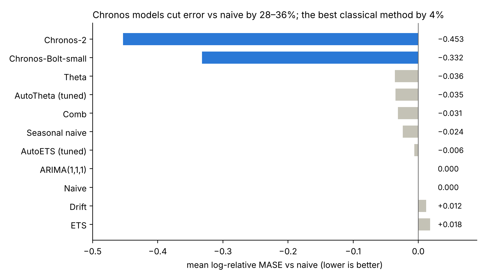

# ForecastClean — Paper draft v0.1

_Draft v0.2 of 2026-11-28. Source of truth for the numbers: `results/gap_fixed/` (RQ2) and `results/chronos_post_tuned3/` (RQ1). Citations marked "to be verified" were checked at summary level only; read them in full before submission._

## Abstract

**Working title:** *Do time-series foundation models still beat classical forecasters on data they cannot have seen? A rolling-origin, release-date-aware evaluation.*

Pretrained time-series foundation models (Chronos-Bolt, Chronos-2, TimesFM 2.5) keep a clear accuracy lead over classical forecasters when scored only on windows that start after their release dates, and we find no consistent sign that this lead is a leakage artefact. On 25 daily series (ECB exchange rates, Wikipedia pageviews, GB electricity demand) with rolling origins after 31 Oct 2025, the mean log-relative MASE against naive is −0.470 for TimesFM 2.5, −0.453 for Chronos-2 and −0.332 for Chronos-Bolt-small, against −0.036 for the best classical method (Theta); tuning ETS, Theta and ARIMA automatically does not close the gap. The lead comes entirely from electricity demand and Wikipedia pageviews: on the ten exchange-rate series no model, foundation or classical, is distinguishable from the random walk. To test for contamination we compare each model's skill before and after its own release date with a difference-in-differences gap measured against classical models. The mean gap is negative for all three models (−0.097 to −0.226 over 26 series) and is not positive under any robustness check we ran, but it is driven by eight calendar-event Wikipedia pages whose gap is unstable across origin samples. On the other 18 series it is within ±0.04 with intervals that include zero. The one consistently positive case is hourly electricity demand (Chronos-2 and TimesFM 2.5), which is a single series and which we cannot yet explain. Release dates are conservative stand-ins for undisclosed training cutoffs, so a null result bounds the leakage we can detect but does not rule it out. All code, data checksums and results are public.

## 1 Introduction

A foundation-model lead over classical forecasters only means something if the test data was not in the model's pretraining corpus. Most pretraining corpora are only partly documented, benchmark series are reused across papers, and correlated series can leak across a train-test split even when no value is copied (Meyer et al. 2025, to be verified). The simplest defence is to score only windows after a model's release date, since a 2026 observation cannot be in a 2025 checkpoint.

That defence is now common, and it has two weak points. The closest post-release study we found scores a single forecast origin and no horizon sweep, so it cannot say how much a ranking moves with the origin or the horizon (Moghadasi and Ghaderi 2026, to be verified). And they treat post-release data as clean by construction, without asking whether the *same* models look different on earlier data they may have seen (Moghadasi and Ghaderi 2026, to be verified).

We ask two questions about Chronos-Bolt and Chronos-2 against classical forecasters:

1. **Skill on clean data (RQ1).** Is the foundation-model lead still there when every window starts after the model's release date, with identical context length and tuned classical baselines?
2. **Leakage signature (RQ2).** Does a model lose more skill, relative to classical models, after its release than before it?

**Contributions.**

- A rolling-origin protocol with an asserted no-look-ahead check, equal context length for every window, and release-date cutoffs taken per model.
- A difference-in-differences gap that separates a data shift common to all models from a loss specific to the foundation model.
- Evidence on 25 real series that the lead survives tuned baselines (RQ1) and that no consistent leakage signature appears (RQ2), with robustness checks and an explicit list of what the null result cannot exclude.
- A reproducible pipeline: public code, 38 automated tests, and data checksums for every run.

## 2 Related work

*Status: every entry below was checked at abstract or summary level only. Read each paper in full and fix wording before submission.*

**Leakage in foundation-model evaluation.** Meyer et al. (arXiv 2510.13654) name two kinds of leakage: reuse of the same samples in pretraining and test sets, and temporal overlap between correlated series. They recommend a global post-training test period that starts after the latest pretraining timestamp of every compared model. Our per-model release-date cutoffs and the global clean-from date in the RQ1 runs follow that rule. Aksu et al. (GIFT-Eval, 2410.10393) build a benchmark with a non-leaking pretraining set and show that leakage raises measured performance.

**Post-release hold-outs.** Moghadasi and Ghaderi (2609.10357) score 13 methods from one forecast origin on 1 Jan 2026 across seven data groups, including ECB exchange rates and Wikipedia pageviews, and find the pretrained models ahead in most groups but tied with classical methods on exchange rates. They argue that post-release data may still be familiar to a model. Ebrahim et al. (2610.00589) find TimesFM-3 level with classical methods on FRED-MD series observed after its documented training data. Several other post-cutoff or live benchmarks exist, so the post-cutoff idea alone is not new.

**Contamination detection.** Li et al. (TSFMAudit, 2605.26161) detect contamination from the model side, using how fast a model adapts under fine-tuning. We detect it from the outcome side, from a drop in skill against classical models after release. The two are complementary.

**Where this paper sits.** We use rolling origins strictly after each release date rather than one origin, a horizon sweep, tuned classical baselines, and a pre-versus-post difference-in-differences gap with robustness checks. We do not claim a new detection method for contamination.

## 3 Evaluation protocol

Every number in this paper comes from rolling-origin forecasts scored against naive, with the same context length for every window and a cutoff date for every model.

**Windows.** For each series we take forecast origins at evenly spaced positions. A forecaster sees only the observations before the origin, and the code asserts this. Every window uses the last 1024 observations as context (a minimum and a maximum), so early windows cannot be penalised for having less history. The horizon is fixed per frequency: 10 steps for business-daily exchange rates, 14 for daily series, 24 for hourly series.

**Metric.** Errors are MASE, scaled by the in-sample seasonal-naive error of the context (season 1 for exchange rates, 7 for daily, 24 for hourly). Skill is the ratio of mean MASE to the mean MASE of naive, and we report the mean of its logarithm across series. A value of −0.453 means the model's error is about 36% below naive in the geometric sense; 0 means no better than naive.

**RQ1: clean windows.** Only windows whose target starts after the latest release date among the compared foundation models (31 Oct 2025, Chronos-2) are scored.

**RQ2: the contamination gap.** Each foundation model *m* has a release date *r*. Pre-release windows have targets ending on or before *r* and could have been seen. Post-release windows start after *r* and cannot have been. For each series, with *c* the set of classical models:

```latex
\mathrm{gap}(k) = \log \mathrm{rel}_k^{\mathrm{post}} - \log \mathrm{rel}_k^{\mathrm{pre}}, \qquad \mathrm{DiD}_m = \mathrm{gap}(m) - \operatorname{median}_{k \in c}\, \mathrm{gap}(k)
```

A positive DiD means the foundation model lost more skill after release than classical models did, which is the signature of leakage. Subtracting the classical median removes a data shift that affects all models alike. A positive DiD is a signature, not proof, and a zero DiD does not prove the data was unseen.

**Cutoffs.** Training cutoffs are not published for these models, so we use release dates: Chronos-Bolt 1 Dec 2024 (rounded late) and Chronos-2 31 Oct 2025. A later date than the true release can only shrink the clean set. We checked both dates on 27 Nov 2026: the Chronos GitHub news lists Chronos-Bolt on 26 Nov 2024 and Chronos-2 on 20 Oct 2025, and the Chronos-2 paper appeared on arXiv on 17 Oct 2025. Our cutoffs are later than both. Neither model card states a data cutoff, and both models are Apache-2.0.

**Statistics.** Intervals for the gap are bootstrapped over series, with variants described in Section 5.3. The framework also implements Diebold–Mariano tests with the Harvey correction and Holm correction, and Kendall-tau ranking stability over resampled origins and series; the ranking-stability result is reported in Section 5.1.

## 4 Experimental setup

**Data.** We downloaded 29 public series and used 26. Three FRED-MD macro series end in 2025, before the Chronos-2 release date, so they have no post-release windows and are excluded. Raw data is not stored in the repository because licences are not yet confirmed; each run records file checksums in a manifest.

| Group | Series | Frequency | Horizon | Used in |
| --- | --- | --- | --- | --- |
| ECB exchange rates | EUR against USD, GBP, JPY, CHF, CAD, AUD, SEK, NOK, CNY, INR | business daily | 10 | RQ1, RQ2 |
| Wikipedia pageviews | 14 articles (6 general: Python, Bitcoin, Cricket, Weather, Machine learning, Taylor Swift; 8 calendar-event: Christmas, Easter, Halloween, Thanksgiving, Wimbledon, Super Bowl, Ramadan, Eurovision) | daily | 14 | RQ1, RQ2 |
| GB electricity demand (NESO) | national demand, daily | daily | 14 | RQ1, RQ2 |
| GB electricity demand (NESO) | national demand, hourly | hourly | 24 | RQ2 only (too slow for the tuned run) |
| FRED-MD | UNRATE, CPIAUCSL, INDPRO | monthly | 6 | excluded (no post-release data) |

The event pages were fixed in code before any per-page results were examined.

**Foundation models.** Chronos-Bolt-small and Chronos-2, run with their public weights and median forecasts (Chronos-Bolt-tiny only for a smoke test). Chronos-2 receives each series as a single-variate input with no covariates.

**Classical baselines.** Naive, seasonal naive, drift, ETS, ARIMA(1,1,1), Theta, and Comb (the average of ETS, ARIMA and Theta). For RQ1 we add three tuned baselines, AutoETS, AutoTheta and AutoARIMA, from statsforecast. AutoARIMA ran only on non-seasonal series (the exchange rates) because it takes 5 s per fit on daily data and 23 s on hourly data, so it is not part of the cross-series ranking. In the RQ2 runs ARIMA was dropped for speed and the classical reference is the median over ETS, Theta, Comb, drift and seasonal naive.

**Windows.** RQ1: up to 30 post-release origins per series. RQ2: up to 40 origins before and 40 after each release date (26 to 40 after, depending on how much data exists), context 1024 in every window.

**Code and runs.** The pipeline is public (`github.com/mirzayasirabdullahbaig07/ForecastClean`). RQ1 ran at commit `e7dc9ee`; RQ2 at commit `8c4247d`, both on a Colab T4 GPU.

## 5 Results

### 5.1 Skill on clean data (RQ1)

On 25 series and windows that start after 31 Oct 2025, all three foundation models beat every classical method, tuned or not. Mean log-relative MASE against naive is −0.470 for TimesFM 2.5, −0.453 for Chronos-2 and −0.332 for Chronos-Bolt-small, which is about 37%, 36% and 28% lower error. The best classical methods score −0.036 (Theta) and −0.035 (AutoTheta), about 4% below naive, and AutoETS scores −0.006. Tuning does not change the picture: AutoTheta is no better than untuned Theta, and AutoETS is only slightly better than untuned ETS.



*Figure 1. Mean log-relative MASE vs naive, 25 series, laptop run of 2026-11-28 (`results/chronos_post_tuned3/`). AutoARIMA not ranked. Regenerate with `python paper/make_fig1.py`.*

TimesFM 2.5 and Chronos-2 are close (−0.470 vs −0.453), and we do not claim one is better. The ranking is moderately stable: across resamples of origins and series the best model stays the best with probability 0.69, and the mean Kendall tau between resampled rankings is 0.77. This is lower than in the Chronos-only run, which is what one expects when two models are nearly tied at the top.

**The lead depends on the data group.** Table 1 gives mean log-relative MASE by group (`skill_by_group.csv`).

| Group (series) | TimesFM 2.5 | Chronos-2 | Chronos-Bolt-small | Theta | Comb | Seasonal naive |
|---|---:|---:|---:|---:|---:|---:|
| ECB exchange rates (10) | −0.007 | −0.013 | +0.055 | +0.007 | +0.001 | 0.000 |
| GB electricity demand, daily (1) | −0.624 | −0.618 | −0.432 | −0.170 | −0.217 | −0.195 |
| Wikipedia, calendar-event pages (8) | −1.080 | −1.028 | −0.774 | −0.001 | +0.029 | −0.070 |
| Wikipedia, other pages (6) | −0.403 | −0.391 | −0.371 | −0.131 | −0.136 | +0.026 |

On the ten exchange-rate series every model is within about 0.06 of naive, and Chronos-Bolt-small is slightly worse than naive. This matches an earlier finding that methods tie on exchange rates (Moghadasi and Ghaderi 2026, to be verified). The headline gain therefore comes from the 15 non-FX series, and the largest gains are on pages with strong yearly or weekly calendar structure (Halloween, Thanksgiving, Christmas), which is where a model that has seen many similar series should help most. The ten EUR pairs also share a currency, so the effective number of independent series is smaller than 25, and electricity is a single series.

### 5.2 The contamination gap (RQ2)

We ran the gap twice: once with up to 40 pre-release and 40 post-release origins per series for the two Chronos models (`results/gap_fixed/`, 2026-11-25), and once with 20 origins per period for all three models (`results/gap_blocks/`, laptop, 2026-11-28). A positive difference-in-differences (DiD) means the model lost more skill after its release than classical models did. Neither run shows a consistent leakage signature: no model has a positive mean DiD across the 26 series.

Table 2. DiD, 20-origin run, 26 series, 95% interval bootstrapped over series.

| Model | Group | Series | Mean DiD | 95% interval | Series with DiD > 0 |
| --- | --- | --- | --- | --- | --- |
| Chronos-Bolt-small | all | 26 | −0.191 | [−0.457, 0.020] | 12 |
| Chronos-Bolt-small | exchange rates | 10 | −0.028 | [−0.074, 0.019] | 4 |
| Chronos-Bolt-small | Wikipedia | 14 | −0.341 | [−0.807, 0.063] | 7 |
| Chronos-Bolt-small | electricity | 2 | +0.040 | [−0.014, 0.094] | 1 |
| Chronos-2 | all | 26 | −0.226 | [−0.414, −0.049] | 7 |
| Chronos-2 | exchange rates | 10 | −0.023 | [−0.052, 0.008] | 3 |
| Chronos-2 | Wikipedia | 14 | −0.399 | [−0.722, −0.101] | 3 |
| Chronos-2 | electricity | 2 | −0.024 | [−0.216, 0.168] | 1 |
| TimesFM 2.5 | all | 26 | −0.097 | [−0.270, 0.050] | 8 |
| TimesFM 2.5 | exchange rates | 10 | −0.018 | [−0.036, −0.001] | 3 |
| TimesFM 2.5 | Wikipedia | 14 | −0.189 | [−0.473, 0.072] | 4 |
| TimesFM 2.5 | electricity | 2 | +0.157 | [−0.015, 0.330] | 1 |

**The event pages are not stable.** The headline means are driven by the eight calendar-event Wikipedia pages (Christmas, Easter, Halloween, Thanksgiving, Wimbledon, Super Bowl, Ramadan, Eurovision), which have large effects of both signs. Across the two runs the per-series DiD for Chronos-2 correlates only 0.27 (Chronos-Bolt-small: 0.62), and individual pages change sign: Thanksgiving goes from +0.11 to −1.53 and Christmas from +0.63 to −0.72 when the origin sample is halved. On a yearly-seasonal page the result depends on where the sampled origins fall in the calendar, so we do not read anything into these eight pages. The mean over the other 18 series is more stable (Table 3).

Table 3. Mean DiD over the 18 series that are not calendar-event pages (10 exchange rates, 6 other Wikipedia pages, 2 electricity series).

| Model | 40-origin run | 20-origin run |
| --- | --- | --- |
| Chronos-Bolt-small | −0.009 [−0.055, 0.037] | +0.018 [−0.037, 0.072] |
| Chronos-2 | −0.038 [−0.083, 0.015] | −0.026 [−0.107, 0.071] |
| TimesFM 2.5 | not run | +0.030 [−0.027, 0.100] |

All five intervals include zero and the means are within ±0.04, so on these series we see no gap in either direction. The data do not exclude small positive effects.

**Hourly electricity.** The hourly series has a positive DiD for Chronos-2 in both runs (+0.31 and +0.17) and for TimesFM 2.5 in the one run that includes it (+0.33); for Chronos-Bolt-small it is +0.21 and −0.01. It is one series, so we cannot separate leakage from a change in demand patterns (Section 6).

### 5.3 Robustness

Each check changes one choice and leaves the rest as in Section 5.2. Files: `results/gap_fixed/robust_*.csv` (40 origins, Chronos) and `results/gap_blocks/robust_*.csv` (20 origins, three models), produced by `forecastclean robust`.

| Check (20-origin run) | Chronos-Bolt-small | Chronos-2 | TimesFM 2.5 |
| --- | --- | --- | --- |
| Headline (median classical reference, 26 series) | −0.191 | −0.226 | −0.097 |
| Reference = mean of classical models | −0.181 | −0.203 | −0.095 |
| Reference = each single classical model | −0.259 to −0.132 | −0.246 to −0.119 | −0.154 to −0.000 |
| Ten EUR pairs counted as one unit (17 units) | −0.278 [−0.669, 0.051] | −0.333 [−0.602, −0.082] | −0.138 [−0.395, 0.089] |
| Leave one series out (range) | −0.223 to −0.120 | −0.259 to −0.173 | −0.128 to −0.037 |
| Eight event pages only | −0.662 [−1.334, −0.005] | −0.675 [−1.069, −0.255] | −0.381 [−0.843, 0.037] |
| Six other Wikipedia pages | +0.087 [−0.052, 0.202] | −0.032 [−0.244, 0.245] | +0.067 [−0.066, 0.223] |
| Window-level block bootstrap (blocks of 5 origins) | −0.191 [−0.220, −0.003] | −0.226 [−0.273, −0.030] | −0.097 [−0.199, 0.048] |

No variant makes a mean clearly positive. The event pages are the most influential series: removing Thanksgiving (Chronos-2, TimesFM) or Wimbledon (Chronos-Bolt-small) moves the mean toward zero. The six other Wikipedia pages are slightly positive for two models, but every interval includes zero. The window-level block bootstrap resamples forecast origins within each series; its intervals are narrower than the series-level ones, which is expected because it holds the set of series fixed, and it does not address the instability of the event pages described above.

## 6 Limitations

The null result in Section 5.2 is weaker than it looks, for these reasons.

- **Release dates are not training cutoffs.** A model's real cutoff is earlier than its release date, so some pre-release windows are already clean, and the rest are only possibly seen. Both effects make any measured gap a lower bound. A null result does not show that no contamination exists, and an earlier study argues that familiarity can survive a later hold-out (Moghadasi and Ghaderi 2026, to be verified).
- **Intervals are too narrow.** The bootstrap resamples series as independent, but the EUR pairs share a currency and the Wikipedia pages share news cycles. Counting the EUR pairs as one unit widens the intervals but does not change the conclusion. A window-level block bootstrap (Section 5.3) gives narrower intervals but does not fix this.
- **Unstable event pages.** The per-series gap on the eight calendar-event Wikipedia pages changes a lot, and sometimes flips sign, when the sample of origins changes (Section 5.2). Origins placed to match calendar phase before and after release, or all available origins, would be needed to use these pages.
- **Few series per group.** Electricity has two series, and its positive gap on the hourly series is unexplained. We cannot separate a leakage effect from a change in demand.
- **Classical models are fixed.** ARIMA is a fixed (1,1,1) in most runs and was dropped from the RQ2 runs. Tuned AutoARIMA ran only on non-seasonal series, so the strongest classical competitor is missing on seasonal series.
- **Two foundation-model families.** We run Chronos and TimesFM; we have not run Moirai. Domain familiarity is also not controlled: the public Chronos Datasets collection includes Wikipedia daily traffic, electricity and exchange-rate subsets, and the Chronos-2 card says its training data is a subset of that collection (the cards do not say which subsets). Scoring only windows after release removes overlap in time, but the models may still know these kinds of series.
- **Point forecasts only.** We score MASE of the median forecast. CRPS and weighted quantile loss are not yet reported.
- **Short sample.** Post-release windows cover about one year, so the clean-data result describes one period.
- **Unchecked sources.** The data licences (FRED-MD, ECB, Wikimedia, NESO) are not yet confirmed.

## 7 Conclusion

With identical context, per-model cutoffs and tuned baselines, Chronos-Bolt-small, Chronos-2 and TimesFM 2.5 keep a clear lead over classical forecasters on data released after them, and we find no consistent sign that the lead comes from leakage for any of them (the mean difference-in-differences is not positive for any model, and on the 18 series that are not calendar-event pages it is within ±0.04 with intervals that include zero). The lead is large (about 28%, 36% and 37% below naive MASE) against classical methods that barely beat naive, but it comes entirely from electricity demand and Wikipedia pageviews; on exchange rates every method ties with the random walk. The leakage check cannot prove absence, because cutoffs are undisclosed and the evidence on electricity is open. We recommend that foundation-model comparisons report skill separately before and after each model's release, name their cutoff assumptions, and show how the answer changes when those assumptions change.

## 8 Reproducibility

Code, tests and result files are in the public repository `mirzayasirabdullahbaig07/ForecastClean`. Each run records its command, commit and data checksums (`results/gap_fixed/RUN_INFO.md`, `MANIFEST_colab_2026-11-25.csv`). Raw data is downloaded by `forecastclean download` and is not redistributed. The RQ2 tables come from `forecastclean gap` and `forecastclean robust`; the RQ1 results are in `results/chronos_post_tuned3/` (command in its `RESULT_TABLE.md`).

## Open items before submission

This draft uses only results we have. These items would change or strengthen it; the first four decide whether the paper is ready to send.

| Item | Why it matters | How |
| --- | --- | --- |
| ~~Save the RQ1 result files and report skill by data group~~ | Done 2026-11-28 (`results/chronos_post_tuned3/`, Table 1). | Claude |
| Release dates: checked on 27 Nov 2026, done | The cutoff is the central assumption of RQ2. | Claude, then Faiqa checks |
| Read the two key papers in full and fix Section 2 | Summaries so far are secondhand. | Faiqa, with supervisor |
| ~~Add TimesFM 2.5 and the block bootstrap to RQ2~~ | Done 2026-11-28 (`results/gap_blocks/`). | Claude |
| Re-run the gap on event pages with all origins or calendar-matched origins | Their gap is unstable at 20–40 origins (Section 5.2). | Claude, laptop |
| Explain or bound the electricity result | Hourly electricity is the one consistently positive gap. | Claude: split by regime and season |
| Add probabilistic metrics (CRPS or weighted quantile loss) | Reviewers expect them. | Claude |
| Confirm data licences | Needed before publication. | Faiqa |
| Confirm the gap statement with the supervisor | The post-release idea is crowded. | Faiqa |
| Figures and venue formatting | Draft has one planned figure. | Claude, after the numbers are final |
